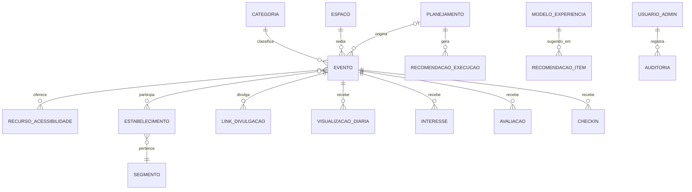

# 04 — Modelo de dados, APIs e integrações

> Revisão 2 · 2026-11-13 · Modelo inicial, que evolui por migrações versionadas. A coluna **Fase** indica quando a tabela é criada.
>
> **Nomes conceituais em português.** No código e no banco, tabelas e colunas ficam **em inglês** [C]; a correspondência está no `GLOSSARY.md` e em `05-arquitetura.md` §6.

## 1. Modelo de dados (PostgreSQL)

### Núcleo (Fase 1)

| Tabela | Campos principais | Observações |
| --- | --- | --- |
| `categoria` | id, nome, slug, ordem, ativa | Semente: Infantil, Música, Gastronomia, Inclusivo/Acessível [C] |
| `recurso_acessibilidade` | id, nome, slug, descricao, icone | Semente: Libras, Espaço sensorial, Pet friendly, Cadeira de rodas, Audiodescrição |
| `espaco` [PDF] | id, nome, piso, referencia, area_m2, capacidade, estrutura (tags: energia, palco, som, cobertura…), ativo | Usado na agenda e no motor de recomendação |
| `evento` | id, slug, titulo, descricao, inicio, fim, fim_real (nulo), espaco_id, local_complemento, categoria_id, banner_caminho, banner_alt, info_entrada, **modo_vagas** (`sem_limite` · `ordem_chegada` · `reserva` [P]), capacidade_informativa, periodo_avaliacao_dias, status_publicacao (`rascunho` · `publicado` · `cancelado`), segredo_checkin (Fase 2), planejamento_id (Fase 2), versao_ics, auditoria (criado_por/em, atualizado_em) | Status temporal derivado (abaixo) |
| `evento_recurso` | evento_id, recurso_id | N:N |
| `link_divulgacao` [PDF] | id, evento_id (nulo = agenda ou filtro), codigo (curto, único), canal (`instagram` · `wifi` · `qr_cartaz` · `qr_totem` · `painel` · `link_direto` · `outro`), descricao, destino (caminho + filtros), criado_por, ativo | `/r/{codigo}` grava a origem e redireciona; o QR codifica essa URL |
| `visualizacao_diaria` | evento_id (nulo = agenda), dia, id_hash, origem_canal, link_id | `UNIQUE(evento_id, dia, id_hash)`; agregada e apagada após a retenção |
| `contagem_diaria` | evento_id, dia, origem_canal, link_id, unicos, brutos | Agregado sem ID (longo prazo) |
| `acao_engajamento` | evento_id, id_hash, tipo (`compartilhar` · `agenda_ics` · `agenda_google`), dia | `UNIQUE(evento_id, id_hash, tipo, dia)` |
| `interesse` | evento_id, id_hash, criado_em | `UNIQUE(evento_id, id_hash)`; desligar = apagar · tabela `event_interests` (migração 0008); 90 dias após o fim do evento vira o total em `event_interest_totals` |
| `usuario_admin` | id, nome, email, senha_hash (Argon2id), papel, ativo, troca_senha_obrigatoria, totp_segredo, falhas_login, bloqueado_ate | Sem cadastro aberto |
| `sessao` | id (hash), usuario_id, expira_em, criado_em | Ociosa 8 h; absoluta 7 dias |
| `auditoria` | id, usuario_id, acao, entidade, entidade_id, criado_em, detalhes (sem dados pessoais) | |
| `importacao_eventos` (B-94) | id, criado_por, nome_arquivo, linhas (células como texto), confirmada_em, resumo (só contagens e ids dos eventos), criado_em | Tabela `event_imports` (migração 0009); apagada após 7 dias. O evento ganha `codigo_importacao` único (`events.import_code`) |
| `configuracao` | chave, valor | Período de avaliação, tolerâncias, Turnstile, pesos do motor |

### Participação, avaliação e inteligência (Fase 2)

| Tabela | Campos principais | Observações |
| --- | --- | --- |
| `interesse_snapshot` | evento_id, total, congelado_em, momento (`inicio` · `fim`) | |
| `avaliacao` | id, evento_id, id_hash, nota, tags, comentario (≤ 280), com_checkin, oculta, criado_em | `UNIQUE(evento_id, id_hash)` |
| `sugestao` | id, texto (≤ 500), categoria_id, id_hash, status, criado_em | Só a administração vê [C] |
| `checkin` [P] | evento_id, id_hash, criado_em, metodo | `UNIQUE(evento_id, id_hash)`; só depois da aprovação do desenho |
| `segmento` [PDF] | id, nome | Alimentação, moda, tecnologia, beleza, lazer… |
| `estabelecimento` [PDF] | id, nome, segmento_id, piso, ativo | **Dado empresarial**; não guardar nome nem contato de pessoas [R] |
| `evento_estabelecimento` | evento_id, estabelecimento_id | |
| `planejamento` [PDF] | id, titulo, objetivo_principal, objetivos_secundarios, publico (faixas, perfis, interesses), segmento_ids, estabelecimento_ids, orcamento_min, orcamento_max, periodo_inicio, periodo_fim, preferencias_dia_hora, espaco_ids, decisao_registrada, licoes, criado_por, criado_em | Público = **descrição do alvo**, não dado de visitantes |
| `modelo_experiencia` [R] | id, nome, descricao, pesos_objetivo, pesos_publico, segmento_ids, custo_min, custo_max, estrutura_necessaria, area_min, duracao_h, categoria_id, indicadores_sugeridos, ativo, atualizado_em | Catálogo editável |
| `recomendacao_execucao` | id, planejamento_id, versao_regras, pesos, entradas (json), criado_por, criado_em | Rastreabilidade |
| `recomendacao_item` | execucao_id, modelo_id, posicao, pontuacao, justificativa (json: regras e premissas), confianca, eliminado_por (nulo) | |
| `data_especial` [R] | data, descricao | Feriados e datas comemorativas para as comparações |

### Reservas e fontes externas (sem fase definida / Fase 3)

| Tabela | Status |
| --- | --- |
| `reserva` | **[P]**: o modelo depende da alternativa escolhida (`03-metricas.md` §6.2). Nada é criado antes da aprovação |
| `fluxo_agregado` (período, área, contagem, fonte) | Fase 3 · depende de fonte e autorização [P] |
| `vendas_agregadas` (período, segmento, valor ou índice, fonte) | Fase 3 · só agregados; depende de fonte, contrato e autorização [P] |

### Status do evento [C][PDF][R]

| Exibido | Regra |
| --- | --- |
| Rascunho | `status_publicacao = rascunho` |
| Cancelado | `status_publicacao = cancelado` |
| Agendado | publicado e `agora < inicio` |
| Em andamento | publicado, `inicio ≤ agora` e `agora < coalesce(fim_real, fim)` |
| Encerrado | publicado e `agora ≥ coalesce(fim_real, fim)` |

A ação **"Encerrar evento"** [PDF] grava `fim_real = agora`. O status nunca é editado à mão, o que evita evento "em andamento" esquecido [R].

### Retenção (proposta; validação pendente P-LGPD-3)

| Dado | Prazo proposto |
| --- | --- |
| `visualizacao_diaria`, `acao_engajamento` com `id_hash` | 30 dias → agregado e apagado |
| `interesse`, `checkin`, (`reserva`) | 90 dias depois do fim do evento → só os agregados ficam |
| `avaliacao` | `id_hash` apagado 90 dias depois do fim; nota, tags e comentário por 2 anos |
| `sugestao` | `id_hash` apagado em 30 dias; texto por 2 anos |
| IP | não vai para o banco; só fica em memória para o limite de requisições; logs por 7 dias |
| Planejamentos, catálogo, relatórios agregados | enquanto úteis (dados empresariais) |
| `auditoria` | 1 ano |

## 2. Rotas principais

| Rota | Uso | Fase | Acesso |
| --- | --- | :-: | --- |
| `GET /`, `/eventos/[slug]` | Agenda e detalhes | 1 | Público |
| `GET /r/[codigo]` | Link curto e QR de divulgação → grava a origem → redireciona | 1 | Público |
| `GET /eventos/[slug]/calendario.ics` | iCalendar | 1 | Público |
| `POST/DELETE /api/eventos/[id]/interesse` | Interesse | 1 | Público (ID) |
| `POST /api/eventos/[id]/engajamento` | Compartilhar e cliques de agenda | 1 | Público (ID) |
| `DELETE /api/meus-dados` | Apagar dados do dispositivo | 1 | Público (ID) |
| `GET /api/saude` | Saúde | 1 | Público |
| `/admin/**` | Eventos, espaços, links e QR, painel básico, usuários | 1 | Sessão + papel |
| `POST /api/eventos/[id]/avaliacoes`, `POST /api/sugestoes` | Avaliação e sugestão | 2 | Público (ID) |
| `/admin/relatorios/**`, `/admin/planejamentos/**`, `/admin/catalogo/**` | Inteligência | 2 | Sessão + papel |
| `POST /api/eventos/[id]/check-in` | Check-in | 2 [P] | Público (ID) |
| `GET /painel` | Modo painel digital (destaques, sem interação) | 3 | Público |

## 3. Integrações e pontos de contato

**Regra [C][PDF]:** cada integração fica isolada atrás de uma interface própria. Se uma integração falhar, a agenda e o painel continuam funcionando e os indicadores dela aparecem como **indisponíveis**.

| Ponto de contato | Fase 1 (sem integração) | Integração (Fase 3) | Requisitos e dependências | Status |
| --- | --- | --- | --- | --- |
| **Portal Wi-Fi Ponto Fibra** | Link de divulgação `canal=wifi` colocado no portal **se** o provedor permitir | Redirecionamento após o login ou bloco da programação no portal | Viabilidade técnica, API e **autorização** da Ponto Fibra e do shopping; comportamento do navegador do portal cativo; **nenhuma troca de dados pessoais** | [P] P-INT-1 |
| **Instagram e redes sociais** | Links de divulgação por evento ou campanha (bio, posts, stories) | — (sem API no escopo) | Nenhuma credencial | Sem bloqueio |
| **QR Codes impressos** (cartazes, totens) | Gerador de QR por link de divulgação (PNG/SVG) | — | Impressão a cargo do shopping | Sem bloqueio |
| **Painéis digitais** | — | Página `/painel` aberta pelo player do painel, ou integração com o sistema do painel | Modelo do equipamento/player, rede, autorização do fornecedor | [P] P-INT-2 |
| **Fluxo de visitantes** | — | Importação agregada (CSV ou API) de sensores ou sistemas existentes | Fonte, formato, frequência, contrato e autorização | [P] P-INT-3 |
| **Vendas agregadas** | — | Importação agregada por período e segmento | Fonte, contrato com lojistas/administradora, autorização, confidencialidade | [P] P-INT-4 |
| **iCalendar / Google Calendar** | `.ics` (RFC 5545) e link do Google (sem documentação oficial: secundário) | — | Nenhuma | Sem bloqueio |
| **Cloudflare Turnstile** | Desligado | — | Conta e chaves em variáveis de ambiente | [P] P-INF-3 |
| **Armazenamento de imagens** | Disco local (volume) | S3-compatível | Depende da hospedagem | [P] P-INF-1 |
| **E-mail / SMS** | Não usado | Só se as reservas com contato forem aprovadas | Provedor, base legal | [P] |
