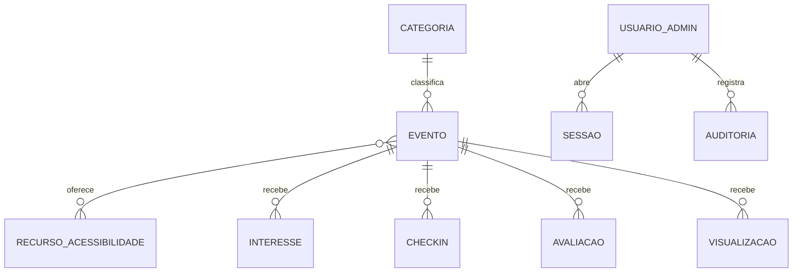

# 04 — Modelo de dados, APIs e integrações

> Papel: **Especialista web** · Modelo inicial, que pode mudar na implementação (migrações versionadas).

## 1. Modelo de dados (PostgreSQL)

| Tabela | Campos principais | Observações |
| --- | --- | --- |
| `categoria` | id, nome, slug, ordem, ativa | Semente: Infantil, Música, Gastronomia, Inclusivo/Acessível |
| `recurso_acessibilidade` | id, nome, slug, descricao, icone | Semente: Libras, Espaço sensorial, Pet friendly, Acessível para cadeira de rodas, Audiodescrição |
| `evento` | id, slug (único), titulo, descricao, inicio (timestamptz), fim, local_nome, local_referencia, categoria_id, banner_caminho, banner_alt, info_entrada (texto), capacidade_informativa (int, nulo), periodo_avaliacao_dias (padrão 7), status_publicacao (`rascunho` · `publicado` · `cancelado`), segredo_checkin, criado_por, criado_em, atualizado_em, versao_ics (int) | Status **temporal** derivado (abaixo) |
| `evento_recurso` | evento_id, recurso_id | N:N |
| `visualizacao_diaria` | evento_id (nulo = agenda), dia, id_hash, origem | `UNIQUE(evento_id, dia, id_hash)`; agregada e apagada após a retenção |
| `contagem_diaria` | evento_id, dia, origem, total | Agregado sem ID (longo prazo) |
| `interesse` | evento_id, id_hash, criado_em | `UNIQUE(evento_id, id_hash)`; desligar = apagar |
| `interesse_snapshot` | evento_id, total, conversao, congelado_em | Gravado no início e no fim do evento |
| `checkin` | evento_id, id_hash, criado_em, metodo (`rotativo` · `estatico`) | `UNIQUE(evento_id, id_hash)` |
| `avaliacao` | id, evento_id, id_hash, nota (1–5), tags (text[]), comentario (≤ 280), com_checkin, oculta, criado_em | `UNIQUE(evento_id, id_hash)` |
| `sugestao` | id, texto (≤ 500), categoria_id (nulo), id_hash, status (`nova` · `lida` · `arquivada`), criado_em | Visível só para a administração |
| `usuario_admin` | id, nome, email (único), senha_hash (Argon2id), papel (`administrador` · `editor` · `analista`), ativo, troca_senha_obrigatoria, totp_segredo (nulo), falhas_login, bloqueado_ate | Sem cadastro aberto |
| `sessao` | id (hash do token), usuario_id, expira_em, criado_em, user_agent_resumo | Expiração ociosa de 8 h; absoluta de 7 dias |
| `auditoria` | id, usuario_id, acao, entidade, entidade_id, criado_em, detalhes (json sem dados pessoais) | Retenção de 1 ano (pendente) |
| `configuracao` | chave, valor | Período de avaliação, tolerâncias do check-in, Turnstile ligado ou desligado |

### Status do evento

O pedido define Agendado, Em andamento e Encerrado. Proposta: guardar só o que a pessoa decide e **derivar** o que depende do relógio, para evitar evento "Em andamento" esquecido.

| Exibido | Regra |
| --- | --- |
| Rascunho | `status_publicacao = rascunho` (não aparece ao público) |
| Cancelado | `status_publicacao = cancelado` (aparece com faixa) |
| Agendado | publicado e `agora < inicio` |
| Em andamento | publicado e `inicio ≤ agora < fim` |
| Encerrado | publicado e `agora ≥ fim` |

### Retenção (proposta, depende de validação do shopping: P-LGPD-3)

| Dado | Prazo |
| --- | --- |
| `visualizacao_diaria` com `id_hash` | 30 dias → agregado em `contagem_diaria` e apagado |
| `interesse`, `checkin` | 90 dias depois do fim do evento → só os agregados ficam |
| `avaliacao` | `id_hash` apagado 90 dias depois do fim; nota, tags e comentário ficam por 2 anos |
| `sugestao` | `id_hash` apagado em 30 dias; texto por 2 anos |
| IP | **não é gravado no banco**; só fica em memória para o limite de requisições (janela de minutos); logs de acesso por 7 dias |
| `auditoria` | 1 ano |

"Apagar meus dados deste dispositivo" remove os registros com o `id_hash` atual e o cookie.

## 2. Rotas e APIs (aplicação única)

As páginas públicas são geradas no servidor. As escritas usam rotas POST com validação (Zod), proteção contra CSRF (verificação de `Origin` + token) e limite de requisições.

| Método e rota | Uso | Acesso |
| --- | --- | --- |
| `GET /` · `GET /eventos/[slug]` | Agenda e detalhes (HTML) | Público |
| `GET /eventos/[slug]/calendario.ics` | Arquivo iCalendar | Público |
| `POST /api/eventos/[id]/interesse` · `DELETE …` | Ligar e desligar interesse | Público (ID) |
| `POST /api/eventos/[id]/avaliacoes` | Enviar avaliação | Público (ID) |
| `POST /api/eventos/[id]/check-in` | Validar token (M\*) | Público (ID) |
| `POST /api/sugestoes` | Enviar sugestão | Público (ID) |
| `DELETE /api/meus-dados` | Apagar dados do dispositivo | Público (ID) |
| `GET /api/saude` | Verificação de saúde | Público (sem detalhes) |
| `/admin/**` (páginas e ações de servidor) | CRUD, dashboard, usuários | Sessão + papel |
| `GET /admin/eventos/[id]/telao/token` | Token atual do QR (M\*) | Editor ou Administrador |

## 3. Integrações

| Integração | Tipo | Requisitos e dependências | Status |
| --- | --- | --- | --- |
| **Portal Wi-Fi Ponto Fibra** | Só um link de destaque para `https://<domínio>/?utm_source=wifi` | Confirmar com a Ponto Fibra: o portal aceita link externo? Abre em navegador interno (CNA) que bloqueia cookies ou downloads? Há liberação antes de autenticar no Wi-Fi? Quem configura? **Nenhuma troca de dados** | Pendente (P-INT-1) |
| **Instagram** | Link na bio e nos posts com `?utm_source=instagram` | Nenhuma credencial; testar o navegador interno do app (download do `.ics`, cookies) | Sem bloqueio |
| **iCalendar (.ics)** | Gerado pelo servidor (RFC 5545): `UID` estável (`evento-{id}@dominio`), `DTSTAMP`, `DTSTART`/`DTEND` em UTC, `SEQUENCE` = `versao_ics`, `SUMMARY`, `LOCATION`, `DESCRIPTION`, `URL`; escaping e quebra de linha testados | Nenhuma | Sem bloqueio |
| **Google Calendar** | Link `calendar.google.com/calendar/render?action=TEMPLATE&…` | **Sem documentação oficial** → opção secundária, com o `.ics` sempre disponível | Sem bloqueio (risco aceito) |
| **Cloudflare Turnstile** | Desafio opcional | Conta Cloudflare + chave de site e chave secreta (variáveis de ambiente) | Desligado; pendente (P-INF-3) |
| **Armazenamento de imagens** | Interface `ArmazenamentoDeArquivos`: disco local (volume) ou S3-compatível | Depende da hospedagem | Pendente (P-INF-1) |
| **E-mail** | Não usado no MVP (senha redefinida pelo Administrador) | SMTP ou provedor se for adotado | Adiado |
| **Domínio e TLS** | Subdomínio do shopping (ex.: `agenda.<shopping>.com.br`) | Acesso ao DNS do shopping | Pendente (P-INF-2) |
